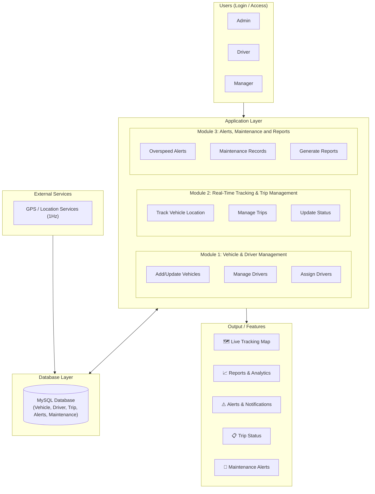

# FleetVisionAI – Intelligent Real-Time Vehicle Tracking & Fleet Management Platform

[](https://nodejs.org/)
[](https://nextjs.org/)
[](https://github.com/VITESH-REDDY473/fleetvisionai/blob/main/backend/src/data/schema.sql)
[]()
[](https://tailwindcss.com/)

**FleetVisionAI** is an enterprise-grade fleet telematics, trip management, and intelligent computer vision platform built with a 3-tier modular architecture.



---

## 🌟 The 3 Core Modules

### 🚗 Module 1: Vehicle & Driver Management
- **Add / Update Vehicles**: Comprehensive fleet inventory supporting Commercial Heavy Trucks, Delivery Vans, and Electric Vehicles (EVs) with VIN, license plate, initial odometer, and fuel/battery capacity.
- **Manage Drivers**: Commercial driver directory storing CDL license credentials, contact details, shift schedules, and safety score performance ratings.
- **Assign Drivers**: Interactive duty assignment linking available commercial drivers to active fleet assets.

### 🗺️ Module 2: Real-Time Tracking & Trip Management
- **Track Vehicle Location**: High-frequency 1Hz GPS tracking grid with dynamic heading orientation, smooth breadcrumbs trail, and multi-layer map styling (**Dark Canvas**, **High-Resolution Satellite**, and **Street View**).
- **VisionAI Edge Dashcam**: Dual-stream neural HUD overlay for in-cabin **Driver Monitoring (DMS drowsiness, phone distraction)** and forward **ADAS (Forward Collision Warning, Lane Departure)**.
- **Manage Trips & Dispatch**: Trip dispatching table with origin, destination, distance, estimated arrival time (ETA), and progress tracking.
- **Update Status**: Dynamic lifecycle transitions (`Scheduled`, `In-Transit`, `Completed`, `Delayed`).

### 🔔 Module 3: Alerts, Maintenance and Reports
- **Overspeed Alerts**: Instant violation logs capturing vehicle speed threshold breaches and geofence speed limit violations with timestamps.
- **Maintenance Records**: Preventative maintenance log for air brakes, high-voltage battery diagnostics, oil replacement, and tire alignment with scheduled dates and technician notes.
- **Generate Reports**: Interactive executive reporting module with key fleet metrics (Total Fleet Distance, Fuel Costs, Safety Index, Carbon Reduction) with **Export CSV** and **Print** capabilities.

---

## 👥 User Roles & Access Control

| Role | Default Account | Capabilities |
| :--- | :--- | :--- |
| **Admin** | `admin@fleetvision.ai` | Full administrative control across Modules 1, 2, and 3 |
| **Manager** | `manager@fleetvision.ai` | Operational supervisor for Trips, Real-Time Tracking, and Reports |
| **Driver** | `driver@fleetvision.ai` | Dedicated Driver Duty Portal showing assigned vehicle telematics, active trip, and maintenance reporting |

---

## 🗄️ Database Layer (MySQL Schema)

The database layer is fully defined in [`backend/src/data/schema.sql`](backend/src/data/schema.sql):

- `drivers`: Personnel records, licenses, safety scores, duty status.
- `vehicles`: Fleet inventory, powertrains, fuel/battery levels, live coordinates.
- `trips`: Dispatch schedules, origins, destinations, distances, ETAs, and completion status.
- `alerts`: Overspeed, collision risks, and geofence infractions.
- `maintenance_records`: Scheduled repairs, technician notes, costs, and priority levels.

---

## 🏗️ Project Structure

```
fleetvisionai/
├── backend/                  # Node.js + Express + WebSocket Telematics Engine
│   ├── src/
│   │   ├── data/
│   │   │   ├── mockData.js   # Vehicles, drivers, trips, maintenance, geofences
│   │   │   └── schema.sql    # MySQL Database DDL & seed data
│   │   ├── routes/
│   │   │   ├── fleet.js      # REST API for Vehicles, Drivers, Trips, Maintenance, Reports
│   │   │   └── alerts.js     # REST API for safety incident events
│   │   ├── simulation/
│   │   │   ├── fleetSimulator.js   # 1Hz GPS movement & CRUD operations
│   │   │   └── visionSimulator.js  # DMS & ADAS AI event generator
│   │   ├── server.js         # HTTP server initialization
│   │   └── socket.js         # Real-time WebSocket stream (1Hz)
│   └── package.json
├── frontend/                 # Next.js 14 Operations Command Center
│   ├── src/
│   │   ├── app/
│   │   │   ├── page.tsx      # Main 3-module command center
│   │   │   └── login/page.tsx# Dedicated login route
│   │   ├── components/
│   │   │   ├── Module1VehicleDriver.tsx           # Module 1: Vehicle & Driver Management
│   │   │   ├── Module2TrackingTrips.tsx           # Module 2: Tracking & Trip Dispatch
│   │   │   ├── Module3AlertsMaintenanceReports.tsx# Module 3: Alerts, Maintenance & Reports
│   │   │   ├── DriverPortal.tsx                   # Dedicated Driver View
│   │   │   ├── FleetMap.tsx                       # Leaflet map (Dark/Satellite/Street)
│   │   │   ├── VisionAIDashcam.tsx                # Dual-view AI dashcam HUD
│   │   │   ├── LoginPage.tsx                      # 3-role portal login
│   │   │   └── Header.tsx                         # Header with role badge & logout
│   │   └── lib/
│   │       ├── auth.tsx      # Role-based authentication manager
│   │       └── socket.ts     # Real-time WebSocket hook
│   └── package.json
├── render.yaml               # Render 1-click blueprint deployment
├── package.json              # Workspace root scripts
└── README.md
```

---

## 🚀 Running the Project Locally

### 1. Install Dependencies
```bash
npm --prefix backend install
npm --prefix frontend install
```

### 2. Start the Backend (Port 5000)
```bash
npm --prefix backend start
```

### 3. Start the Frontend (Port 3000)
```bash
npm --prefix frontend start
```

Open **[http://localhost:3000](http://localhost:3000)** in your web browser.

---

## 🌐 Deploying to Render

This repository includes a [`render.yaml`](render.yaml) file for automatic deployment:
1. In [dashboard.render.com](https://dashboard.render.com), click **New +** → **Blueprint**.
2. Select your repository `VITESH-REDDY473/fleetvisionai`.
3. Click **Apply** to deploy both the backend gateway and frontend dashboard.
